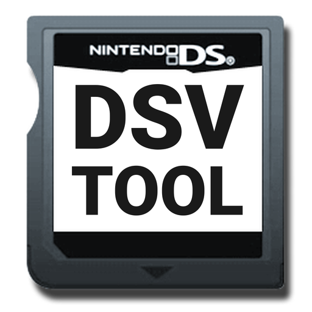
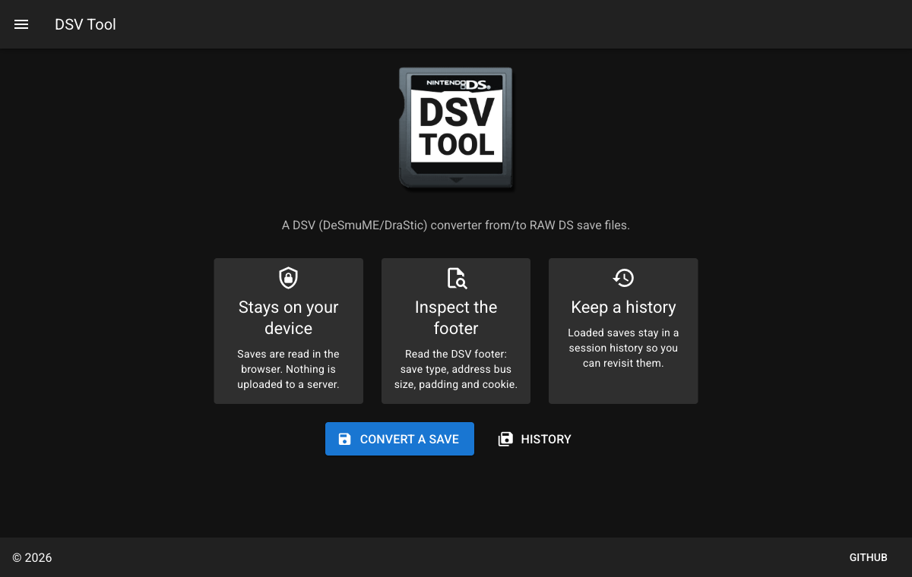

<div align="center">



# DSV Tool

**A DSV (DeSmuME/DraStic) converter from/to RAW DS save files.**

Inspect and convert Nintendo DS emulator saves entirely in your browser —
nothing is uploaded anywhere.

[](https://github.com/albertowd/dsv-tool/actions/workflows/deploy-pages.yml)
[](LICENSE)
[](https://nuxt.com)
[](https://vuetifyjs.com)

**[→ Open the app](https://albertowd.github.io/dsv-tool/)**



</div>

---

## What is a DSV file?

DeSmuME and DraStic append a **40-byte footer** to the raw save data a DS
cartridge would hold. That footer records how the emulator sized the save, and
ends with a 16-byte cookie — `|-DESMUME SAVE-|`:

| Offset | Size | Field                  |
| -----: | ---: | ---------------------- |
|    `0` |    4 | Actually written size  |
|    `4` |    4 | Padded size            |
|    `8` |    4 | Save type              |
|   `12` |    4 | Address bus size       |
|   `16` |    4 | Save size              |
|   `20` |    4 | Version number         |
|   `24` |   16 | Cookie                 |

A `.sav` from real hardware or another emulator is that same save data without
the footer, which is why the two formats are so close and yet refuse to load in
each other's emulator.

## Features

- **Converts both ways.** Export a `.dsv` as a raw `.sav` with the footer
  stripped, or a `.sav` as a `.dsv` with a DeSmuME footer appended. Converting
  a save and converting it back returns the original bytes.
- **Runs entirely in your browser.** Saves are read with the File API and never
  leave your machine — there is no server to upload them to.
- **Reads the DSV footer.** Save type, address bus size, padding, written size
  and cookie, decoded from the bytes.
- **Drop a save on the cartridge**, or click it to pick a `.dsv` / `.sav`.
- **Session history** of everything loaded, each entry re-exportable.
- **Installable.** Ships a web app manifest and service worker, so it works
  offline once loaded.

> [!NOTE]
> History lives in memory for the session — reloading the page clears it.
> Conversion is byte-exact and covered by tests, including a round trip of the
> 512 KB sample save in `app/assets`, but the generated footer has not been
> checked against DeSmuME itself. When a save came from a `.dsv`, its original
> save type and bus width are carried across; for a raw `.sav` those fields are
> derived from the file length.

## Getting started

Requires **Node 24** (see `.nvmrc`).

```bash
npm install
npm run dev          # http://localhost:3000
```

### Everyday commands

| Command                 | What it does                                     |
| ----------------------- | ------------------------------------------------ |
| `npm run dev`           | Dev server with hot reload                        |
| `npm run build`         | Production build                                  |
| `npm run generate`      | Static site into `.output/public`                 |
| `npm start`             | Preview a production build                        |
| `npm test`              | Run the test suite                                |
| `npm run test:coverage` | Tests with a coverage report                      |
| `npm run lint`          | ESLint (`lint:fix` to autofix)                    |
| `npm run typecheck`     | `vue-tsc` over the project                        |

## Testing

85 tests across the models, Pinia stores, the DSV parser and converter, and
the components, run with [Vitest](https://vitest.dev) in a Nuxt environment.

```bash
npm test
npm run test:coverage
```

The parser tests build synthetic DSV buffers, giving every footer field a
distinct value so a mis-indexed read fails loudly instead of quietly matching a
neighbouring field. The converter is checked by round trip — `sav -> dsv -> sav`
must return the original bytes, including for the real save in `app/assets`.

## Code quality

A local [SonarQube](https://www.sonarsource.com/products/sonarqube/) instance
is included for static analysis. It needs Docker, and runs on SonarQube's
embedded database — no external database to set up.

```bash
npm run sonar        # start it, scan, and open the results
```

That brings the container up, waits for it to be ready, collects coverage,
scans, and prints the dashboard URL and login.

| Command                  | What it does                          |
| ------------------------ | ------------------------------------- |
| `npm run sonar`          | Full analysis, start to finish        |
| `npm run sonar:up`       | Start SonarQube only                  |
| `npm run sonar:down`     | Stop it                               |
| `npm run sonar:reset`    | Stop it and wipe its data             |
| `npm run sonar:logs`     | Follow the server log                 |
| `npm run sonar:credentials` | Print and verify the login         |

## Deployment

Pushing to `main` builds the static site and publishes it to GitHub Pages via
[`.github/workflows/deploy-pages.yml`](.github/workflows/deploy-pages.yml). The
workflow lints and tests before it will deploy.

Because a project site is served from `/dsv-tool/` rather than the domain root,
the build takes its base path from `NUXT_APP_BASE_URL`, which the workflow
supplies. Locally it stays `/`, so nothing special is needed for development.

To build the site exactly as CI does:

```bash
NUXT_APP_BASE_URL=/dsv-tool/ npm run generate
```

## Project layout

```
app/
  assets/        Cartridge artwork and Vuetify SASS variables
  components/    CartridgeCard, CartridgeInfo, CartridgeInput
  layouts/       App shell: nav drawer, app bar, footer
  models/        Dsv and DsvInfo
  pages/         /, /convert, /history
  plugins/       DSV parsing, Vuetify setup
  stores/        Pinia: current save, session history
public/          Favicon, PWA icon source, generated icon set
test/            Vitest suite, mirroring app/
```

Components pair a `.vue` template with sibling `.ts` and `.css` files, which the
template pulls in via `<script src>` and `<style src>`.

## Built with

[Nuxt 4](https://nuxt.com) · [Vue 3](https://vuejs.org) ·
[Vuetify 4](https://vuetifyjs.com) · [Pinia](https://pinia.vuejs.org) ·
[Vite PWA](https://vite-pwa-org.netlify.app) · [Vitest](https://vitest.dev) ·
[TypeScript](https://www.typescriptlang.org)

## License

[GPL-3.0](LICENSE)
